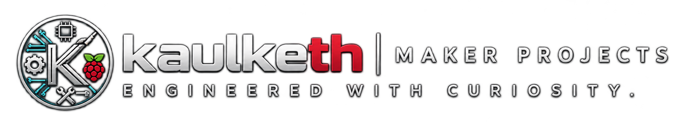
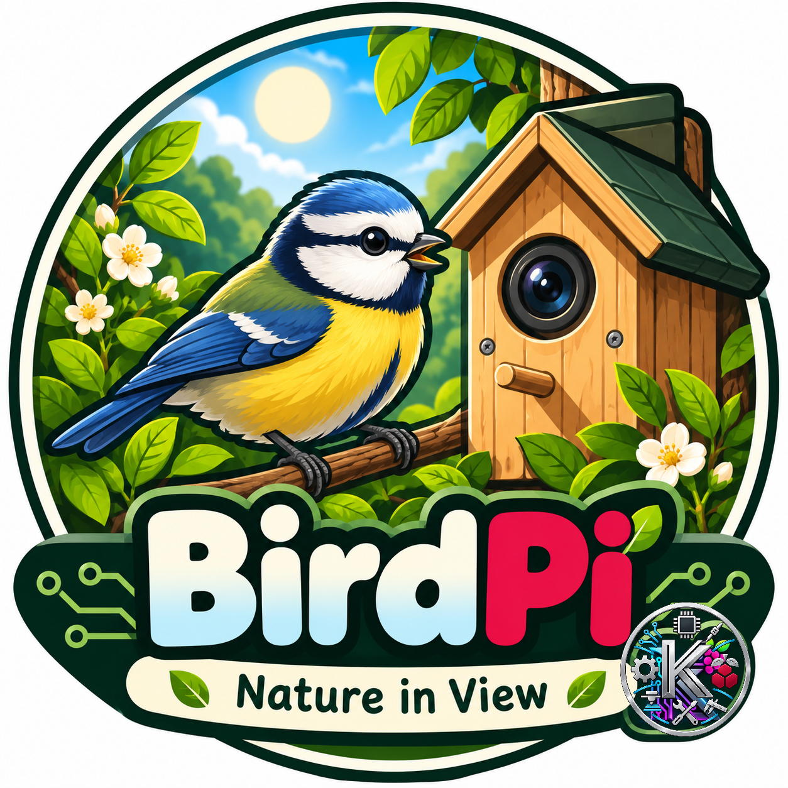
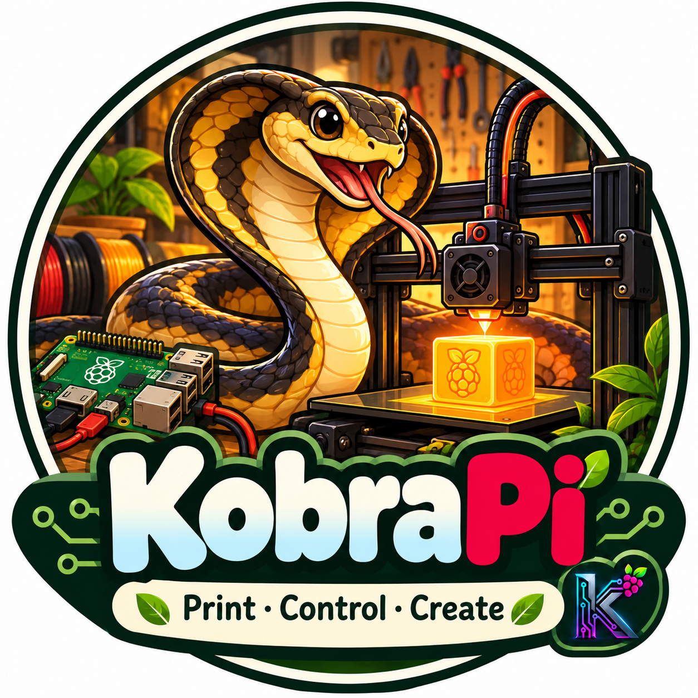

  

---

  RaspPi &bull; ESP &bull; Nordic &bull; Python &bull; Arduino &bull; 3D &bull; Electronics &bull; Automation &bull; Web

---

<table>
<tr>
    <td width="33%" align="center" style="vertical-align:top;">
     
    
      
    

      XIAO nRF52840 powered user interface for BLE e-paper room signs
    

    <a href="https://github.com/kaulketh/outofoffice">
      <b>Explore O³</b>
        
    </a>
  </td>  
    <td width="33%" align="center" style="vertical-align:top;">
     
    
      
    

      Raspberry Pi powered wildlife observation web interface.
    

    <a href="https://github.com/kaulketh/BirdPi">
      <b>Explore BirdPi</b>
         
    </a>
  </td>
    <td width="33%" align="center" style="vertical-align:top;">
     
    
      
    

      Raspberry Pi powered 3D printer control interface.
    

    <a href="https://github.com/kaulketh/KobraPiV2">
      <b>Explore KobraPi</b>
        
    </a>
  </td>
  
</tr>
</table>

---

  kaulketh | Maker Projects

<!--
**kaulketh/kaulketh** is a ✨ _special_ ✨ repository because its `README.md` (this file) appears on your GitHub profile.

Here are some ideas to get you started:

- 🔭 I’m currently working on ...
- 🌱 I’m currently learning ...
- 👯 I’m looking to collaborate on ...
- 🤔 I’m looking for help with ...
- 💬 Ask me about ...
- 📫 How to reach me: ...
- 😄 Pronouns: ...
- ⚡ Fun fact: ...
-->
