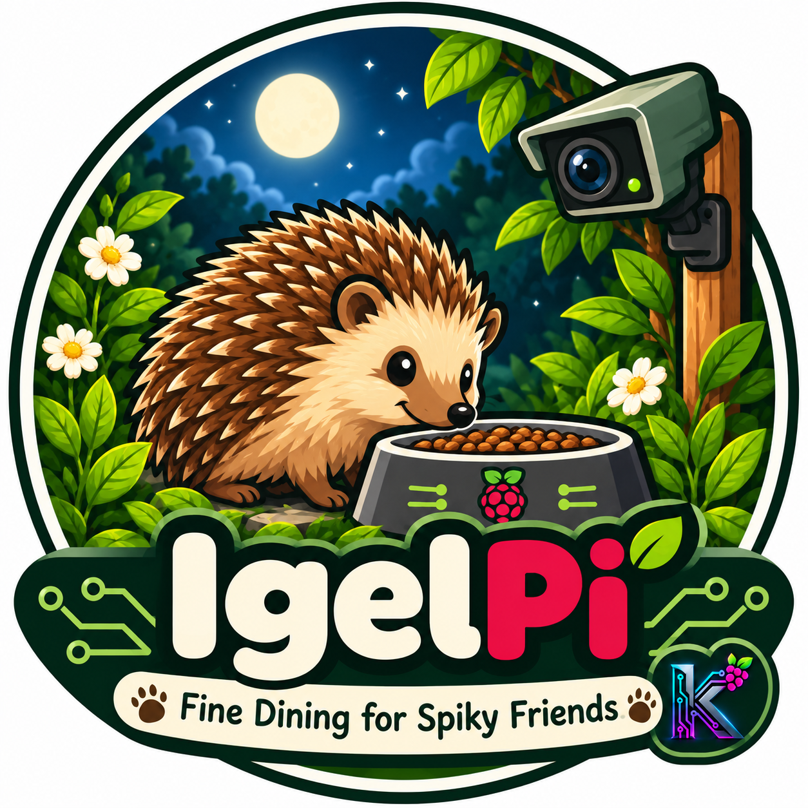

  

  Raspberry Pi &bull; ESP32 &bull; Python &bull;
  3D Printing &bull; Electronics &bull; Automation

---

<table>
<tr>
  <td width="33%" align="center" valign="top">
    
      
    

      Raspberry Pi powered wildlife observation
      with camera and web interface.
    

    <a href="https://github.com/kaulketh/BirdPi">
      <b>Explore BirdPi</b>
    </a>
  </td>
  <td width="33%" align="center" valign="top">
    
      
    

      Raspberry Pi powered 3D printer monitoring,
      control and automation.
    

    <a href="https://github.com/kaulketh/KobraPiV2">
      <b>Explore KobraPi</b>
    </a>
  </td>
  <td width="33%" align="center" valign="top">
    
      
    

      Smart hedgehog feeding station with
      camera and automatic food dispensing.
    

    <b>Coming 2027-2028</b>
  </td>
</tr>
</table>

---

  kaulketh | Maker Projects

<!--
**kaulketh/kaulketh** is a ✨ _special_ ✨ repository because its `README.md` (this file) appears on your GitHub profile.

Here are some ideas to get you started:

- 🔭 I’m currently working on ...
- 🌱 I’m currently learning ...
- 👯 I’m looking to collaborate on ...
- 🤔 I’m looking for help with ...
- 💬 Ask me about ...
- 📫 How to reach me: ...
- 😄 Pronouns: ...
- ⚡ Fun fact: ...
-->
